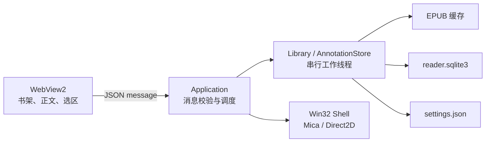

# 架构与 EPUB 处理

## 组件边界

`ui` 只负责 HWND、非客户区、DPI 和 Direct2D 绘制，不读取书库，也不依赖 WebView2。`app` 组合窗口、WebView2 和 `engine`。`engine` 负责 EPUB 的所有持久内容处理，不包含界面或浏览器代码。

WebView2 主页面发 `{id, method, params}` JSON 请求，C++ 返回 `{id, result}` 或 `{id, error}`。命令包含 `bootstrap`、`list`、`import`、`open`、`position`、`bookmark`、`search`、`settings`、`annotations`、`annotation.save`、`annotation.delete`、`lookup`、`copy`、`close`。文件选择器在 COM STA/UI 线程运行；导入、XML、拆分、检索和存储统一由后台串行队列处理，结果通过窗口消息回到 UI 线程。原生 WebView2 对象不跨线程调用。

关闭窗口时前端提交最终位置，再请求关闭；原生设置超时兜底。已进入后台队列的存储操作在应用对象退出时完成。

设置采用版本 2 的两组模型：`application` 包含界面主题、Mica/Direct2D 外壳、动画、选词菜单与查词网站；`reading` 只包含正文排版、分页与翻页动画。旧的扁平设置文件在读取时迁移。C++ 负责枚举本机字体、验证取值、规范化 URL 模板、保存设置，并把外壳变化投递回窗口线程。

标注表位于 `<data-root>/reader.sqlite3`。`annotations` 保存章节与 href、UTF-16 文本偏移、原文、前后 32 个 UTF-16 单元的上下文、笔记、颜色和样式；`bookmarks` 保存章节与相对位置；`migrations` 防止同一本书的旧 JSON 书签重复导入。SQLite 启用 WAL 与完整同步。SQLite 连接与书库对象一样只由串行工作线程访问。

## 导入管线

1. 在 C++ 流式计算源文件 ID，避免重复导入。
2. ZIP 提取到新的 staging/content。拒绝绝对路径、父目录逃逸、反斜线、NTFS ADS、Windows 特殊设备名、重复路径与加密 ZIP。限制 20,000 项、单项 64 MiB、累计 512 MiB；miniz 验证 CRC。
3. 解析 `META-INF/container.xml` → OPF，读取元数据、manifest、spine、封面与阅读方向。跳过 spine 中 `linear=no` 内容，不把它当主阅读顺序。
4. 按 spine 顺序读取 XHTML，收集直接链接的 CSS 与嵌入 CSS，拆分 DOM。
5. 确定每个原始文件的默认目标，以及每个 ID / name 锚点所在的输出文件。
6. 用完整映射修复主阅读文档中的超链接，生成 remap 后的 EPUB3 nav / NCX 目录数据。图片、CSS 和字体保留原目录层级，拆分文件与源文件同目录，因此资源相对路径继续有效。
7. 写入章节纯文本和 `book.json`，将 staging 整体移动为正式书籍目录。

## DOM 拆分策略

参考读取的 calibre 文件：

- `src/calibre/ebooks/oeb/transforms/split.py`：分页边界、大小限制、anchor map 与 `fix_links`。
- `src/calibre/ebooks/oeb/polish/split.py`：在嵌套 DOM 中保留祖先结构的拆分语义。

本实现没有调用 Python/calibre，也没有复制上述文件中的代码。与其构造递归二分树，此处先将正文归约为一组有序、不可拆分的内容单元，为每个容器记录子树的单元区间。分页与大小预算产生区间分段；每个分段复制与其相交的祖先路径和完整内容单元，从而保留有效嵌套、样式继承、列表编号上下文及 head 引用。重复祖先的锚点只保留在第一次出现的位置。列表在跨文件后的连续计数尚未额外重写 `start`，需要后续补齐。

表格、段落、pre、SVG、MathML、figure 和标题被视为原子内容；大于预算时保留而不是截断。普通超长段落内部的智能拆分、pre 空行拆分、完整 CSS 选择器/cascade，与 calibre 更强的容错和转换预处理目前不等价。

## 渲染边界

- `https://app.dr-reader.local` 仅映射发布的 `web/` 静态资源。
- `https://books.dr-reader.local` 仅映射书库目录，用于本地取回缓存 XHTML、封面和资源。
- 应用获取 C++ 已处理的 XHTML，插入确定的本地 base，再放到 `sandbox="allow-same-origin"` 的 srcdoc iframe；不开放 `allow-scripts`。应用仅通过 DOM 注入阅读样式、处理点击和测量浏览器排版后的尺寸。
- 选区和正文标注都发生在 WebView2 中。前端用 CSS Custom Highlight API 绘制五色高亮与下划线，不修改 EPUB 的 XHTML；C++ 只负责数据库校验与持久化。标注恢复时先尝试保存的偏移，再以原文和上下文唯一匹配，重排后偏移变化仍可定位。
- 打开书籍、跨章节翻页与页内翻页使用 Web Animations API。动画受应用设置和 `prefers-reduced-motion` 双重控制，关闭后立即更新页面。
- 书籍 HTML 的 script、事件属性、嵌套 frame、object 等被 C++ 清理；额外 CSP 禁用脚本、网络连接和表单。
- native bridge 只接受来源完全等于应用 `index.html` 的消息；不暴露 host objects、不允许任意文件路径导入、不允许网页导航替换应用或打开新窗口。
- 复制文字、打开外部查词网站由 C++ 原生接口执行；正文脚本始终禁用，原生消息队列限制请求体大小。
- 封面和正文资源仍需浏览器进行字体、图像及 CSS 解码，这属于排版职责。C++ 不尝试复制浏览器布局引擎。

WebView2 本地资源映射参考 [Microsoft 文档](https://learn.microsoft.com/en-us/microsoft-edge/webview2/concepts/working-with-local-content)。云母背景采用 [DWM_SYSTEMBACKDROP_TYPE](https://learn.microsoft.com/en-us/windows/win32/api/dwmapi/ne-dwmapi-dwm_systembackdrop_type)，Windows 11 22H2 以下回退标准标题栏。

## 前端构建与更新成本

pnpm 锁定开发依赖，Vite 以 `web/index.html` 为入口，构建到 `dist/`，资源路径采用相对路径以兼容 WebView2 虚拟主机映射。CMake 的增量依赖包含 HTML、CSS、JS、TS、配置及锁文件；安装包只携带构建后的静态文件。构建先独立执行 `tsc --noEmit`，因为 [Vite 的 TypeScript 转换不负责类型检查](https://vite.dev/guide/features#typescript)。

新下拉组件、字体值与标签转换、章节缓存、图标映射和阅读设置比较使用 TypeScript，已有 DOM 阅读器逐步迁移，不引入框架运行时。图标使用本机 [Segoe Fluent Icons 字体及官方码位](https://learn.microsoft.com/windows/apps/design/iconography/segoe-fluent-icons-font)，旧系统回退 Segoe MDL2 Assets，不打包或重新分发系统字体。

设置变化每帧合并通知，持久化仍按 250 ms 合并；没有变更的词典列表保持 DOM 身份。应用设置变化和重复服务端确认不再重写正文样式。每次标注刷新共用一个章节文本索引，单纯重排保留浏览器 Range；CSS Highlight 自动跟随字体与布局。最近四章使用 LRU 缓存，累计解码字符串最多约 6 MiB，按书籍内容 ID 与章节路径隔离。字体搜索仅修改临时查询，确认选项后才提交原始字体值，每次最多展示 81 个字体选项，避免大量系统字体拖慢弹出列表。

浏览器回归既覆盖源码组件，也在生产包中注入独立测试消息桥，验证开书、分页、字体持久化及图标。SQLite 和真实用户书库不会被该夹具访问。

## 界面视觉基准

应用采用接近用户提供的 Notion 截图的中性灰暗色：主底色 `#191919`，侧栏 `#202020`，浮层 `#252525`。明亮主题使用白底、暖灰文字；纸张主题使用低饱和米色与棕色。蓝色仅用于操作、焦点和选中标记，界面的大面积底色不再带绿。原生 D2D 标题栏同步对应主题的页面底色、文字和悬停颜色。

布局和控件参照 Fluent 2 的 [中性色与语义色分工](https://fluent2.microsoft.design/color)、[层次与阴影](https://fluent2.microsoft.design/elevation) 和 [短时自然动效](https://fluent2.microsoft.design/motion)：使用 4 px 控件圆角与 8 px 面板圆角，轻描边和阴影区分浮层，导航以短条标记选中态。动效遵循应用开关与系统减少动态效果偏好。`reading-palette.ts` 共用 EPUB 正文、主题色卡和排版预览的颜色，避免应用与阅读主题独立时预览串色。
