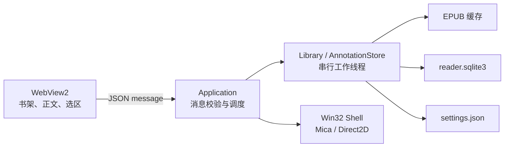

# 架构与 EPUB 处理

## 组件边界

`ui` 只负责 HWND、非客户区、DPI 和 Direct2D 绘制，不读取书库，也不依赖 WebView2。`app` 组合窗口、WebView2 和 `engine`。`engine` 负责 EPUB 的所有持久内容处理，不包含界面或浏览器代码。

WebView2 主页面发 `{id, method, params}` JSON 请求，C++ 返回 `{id, result}` 或 `{id, error}`。命令包含 `bootstrap`、`list`、`import`、`open`、`position`、`bookmark`、`search`、`book.info`、`settings`、`annotations`、`annotation.save`、`annotation.delete`、`lookup`、`copy`、`close`。文件选择器在 COM STA/UI 线程运行；导入、XML、拆分、检索和存储统一由后台串行队列处理，结果通过窗口消息回到 UI 线程。原生 WebView2 对象不跨线程调用。

关闭窗口时前端提交最终位置，再请求关闭；原生设置超时兜底。已进入后台队列的存储操作在应用对象退出时完成。

设置采用版本 2 的两组模型：`application` 包含界面主题、Mica/Direct2D 外壳、动画、选词菜单与查词网站；`reading` 只包含正文排版、分页与翻页动画。旧的扁平设置文件在读取时迁移。C++ 负责枚举本机字体、验证取值、规范化 URL 模板、保存设置，并把外壳变化投递回窗口线程。

标注表位于 `<data-root>/reader.sqlite3`。`annotations` 保存章节与 href、UTF-16 文本偏移、原文、前后 32 个 UTF-16 单元的上下文、笔记、颜色和样式；`bookmarks` 保存章节与相对位置；`migrations` 防止同一本书的旧 JSON 书签重复导入；`agent_sessions` 与 `agent_messages` 保存每本书的 AI 问书对话（删除会话时级联删除消息，删除图书时一并删除）。新表只追加不改旧表，`user_version` 仍为 3，旧版本可照常打开。SQLite 启用 WAL 与完整同步。SQLite 连接与书库对象一样只由串行工作线程访问。

## 导入管线

1. 在 C++ 流式计算源文件 ID，避免重复导入。
2. ZIP 提取到新的 staging/content。拒绝绝对路径、父目录逃逸、反斜线、NTFS ADS、Windows 特殊设备名、重复路径与加密 ZIP。限制 20,000 项、单项 64 MiB、累计 512 MiB；miniz 验证 CRC。
3. 解析 `META-INF/container.xml` → OPF，读取元数据、manifest、spine、封面与阅读方向。跳过 spine 中 `linear=no` 内容，不把它当主阅读顺序。
4. 按 spine 顺序读取 XHTML，收集直接链接的 CSS 与嵌入 CSS，拆分 DOM。
5. 确定每个原始文件的默认目标，以及每个 ID / name 锚点所在的输出文件。
6. 用完整映射修复主阅读文档中的超链接，生成 remap 后的 EPUB3 nav / NCX 目录数据。图片、CSS 和字体保留原目录层级，拆分文件与源文件同目录，因此资源相对路径继续有效。目录标题参考 calibre `oeb/reader.py` 的 `_toc_from_navpoint` 压缩空白；部分转换工具会在章节号和章名之间写入未转义的 `<@>` 一类标记，calibre 的 lxml 恢复解析只会丢掉 `<`，显示成 `@>`，本项目改为把尖括号内只有 1～3 个 ASCII 符号的标记视为分隔符，替换成一个空格。旧书在读取时按 `tocTitleVersion` 原地清理一次目录标题，不改动阅读位置、书架和标注。
7. 写入章节纯文本和 `book.json`，将 staging 整体移动为正式书籍目录。

## 隐私书架

`Library::shelves` 总是在首位提供 ID 为 `private` 的“隐私书架”；旧书库中已有同名书架时直接转为隐私书架，名称为保留名称，不能重命名或重复创建。首页右键“隐藏图书”把书加入隐私书架，“取消隐藏”将其移出。隐藏的图书只在隐私书架中显示，不出现在全部图书、最近阅读等列表、侧栏计数、作者列表、搜索和其他书架里；编辑其他书架时不列出隐藏图书，但保留它们原有的书架归属。

## 图书信息与字数统计

首页右键菜单的“查看信息”和阅读工具栏的信息按钮（Segoe Fluent Icons U+E946）都调用 `book.info`。`Library::info` 每次从缓存的 OPF 重新读取元数据，因此旧书无需重新导入或迁移；`book.json` 中的书名、作者等只作为 OPF 无法读取时的回退。

元数据的读取顺序参考 calibre `src/calibre/ebooks/metadata/opf3.py` 的 `read_title`、`read_authors`、`read_series`、`read_pubdate`、`read_identifiers`、`read_tags`、`read_comments`：先用 EPUB 3 `refines`（title-type、role、display-seq、collection-type、group-position），再回退到 OPF 2 的 `opf:role` / `opf:scheme` 和 `calibre:series`。作者只取 `aut` 角色，没有角色时取全部 creator，再没有时回退到编者；译者、编者和插画单独列出。ISBN 校验位不正确时丢弃，uuid 和 calibre 标识符不显示。HTML 简介转为纯文本段落。

字数规则沿用 calibre `src/calibre/utils/wordcount.py` 的 `get_wordcount` 思路：东亚文字逐字计数，其他文字按词计数。calibre 把码位大于 U+3000 的字符一律算作一个字，本项目改为按文字类别判断：汉字、假名和重复记号逐字计数；连续的字母或数字算一个词，词中的 `'`、`’`、`-` 以及数字之间的 `.`、`,` 不拆词；标点、符号和 emoji 单独计数，从而得到“含标点”与“不含标点”两个总数。全角拉丁字母按单词计数，韩文按空格分词。统计时重新解析章节 XHTML，跳过 head、script、style、`rt` 与 `rp`，行内元素不插入分隔符，避免首字下沉 `The` 被拆成两个词；XHTML 解析失败时才退回搜索文本。

## DOM 拆分策略

参考读取的 calibre 文件：

- `src/calibre/ebooks/oeb/transforms/split.py`：分页边界、大小限制、anchor map 与 `fix_links`。
- `src/calibre/ebooks/oeb/polish/split.py`：在嵌套 DOM 中保留祖先结构的拆分语义。

本实现没有调用 Python/calibre，也没有复制上述文件中的代码。与其构造递归二分树，此处先将正文归约为一组有序、不可拆分的内容单元，为每个容器记录子树的单元区间。分页与大小预算产生区间分段；每个分段复制与其相交的祖先路径和完整内容单元，从而保留有效嵌套、样式继承、列表编号上下文及 head 引用。重复祖先的锚点只保留在第一次出现的位置。列表在跨文件后的连续计数尚未额外重写 `start`，需要后续补齐。

表格、段落、pre、SVG、MathML、figure 和标题被视为原子内容；大于预算时保留而不是截断。普通超长段落内部的智能拆分、pre 空行拆分、完整 CSS 选择器/cascade，与 calibre 更强的容错和转换预处理目前不等价。

## 渲染边界

- `https://app.dr-reader.local` 仅映射发布的 `web/` 静态资源。
- `https://books.dr-reader.local` 仅映射书库目录，用于本地取回缓存 XHTML、封面和资源。
- 应用获取 C++ 已处理的 XHTML，插入确定的本地 base，再放到 `sandbox="allow-same-origin"` 的 srcdoc iframe；不开放 `allow-scripts`。应用仅通过 DOM 注入阅读样式、处理点击和测量浏览器排版后的尺寸。
- 选区和正文标注都发生在 WebView2 中。前端用 CSS Custom Highlight API 绘制五色高亮与下划线，不修改 EPUB 的 XHTML；C++ 只负责数据库校验与持久化。标注恢复时先尝试保存的偏移，再以原文和上下文唯一匹配，重排后偏移变化仍可定位。
- 打开书籍、跨章节翻页与页内翻页使用 Web Animations API。动画受应用设置和 `prefers-reduced-motion` 双重控制，关闭后立即更新页面。
- 书籍 HTML 的 script、事件属性、嵌套 frame、object 等被 C++ 清理；额外 CSP 禁用脚本、网络连接和表单。
- native bridge 只接受来源完全等于应用 `index.html` 的消息；不暴露 host objects、不允许任意文件路径导入、不允许网页导航替换应用或打开新窗口。
- 复制文字、打开外部查词网站由 C++ 原生接口执行；正文脚本始终禁用，原生消息队列限制请求体大小。
- 封面和正文资源仍需浏览器进行字体、图像及 CSS 解码，这属于排版职责。C++ 不尝试复制浏览器布局引擎。

WebView2 本地资源映射参考 [Microsoft 文档](https://learn.microsoft.com/en-us/microsoft-edge/webview2/concepts/working-with-local-content)。云母背景采用 [DWM_SYSTEMBACKDROP_TYPE](https://learn.microsoft.com/en-us/windows/win32/api/dwmapi/ne-dwmapi-dwm_systembackdrop_type)，Windows 11 22H2 以下回退标准标题栏。

## 前端构建与更新成本

pnpm 锁定开发依赖，Vite 以 `web/index.html` 为入口，构建到 `dist/`，资源路径采用相对路径以兼容 WebView2 虚拟主机映射。CMake 的增量依赖包含 HTML、CSS、JS、TS、配置及锁文件；安装包只携带构建后的静态文件。构建先独立执行 `tsc --noEmit`，因为 [Vite 的 TypeScript 转换不负责类型检查](https://vite.dev/guide/features#typescript)。

前端全部使用 TypeScript（`strict`），不引入框架运行时；Node 直接剥离类型运行单元测试，因此只使用可擦除的 TS 语法（`erasableSyntaxOnly`）。界面图标使用 [Material Symbols Rounded](https://fonts.google.com/icons)：`scripts/material-icons.ts` 从固定版本的 `@material-symbols/svg-400` 中只抽取用到的路径，生成 `web/material-icons.ts` 内联到产物，运行时无需图标字体或网络。设置与作者图标保留本机 [Segoe Fluent Icons 字体及官方码位](https://learn.microsoft.com/windows/apps/design/iconography/segoe-fluent-icons-font)，旧系统回退 Segoe MDL2 Assets，不打包或重新分发系统字体。

设置变化每帧合并通知，持久化仍按 250 ms 合并；没有变更的词典列表保持 DOM 身份。应用设置变化和重复服务端确认不再重写正文样式。每次标注刷新共用一个章节文本索引，单纯重排保留浏览器 Range；CSS Highlight 自动跟随字体与布局。最近四章使用 LRU 缓存，累计解码字符串最多约 6 MiB，按书籍内容 ID 与章节路径隔离。字体搜索仅修改临时查询，确认选项后才提交原始字体值，每次最多展示 81 个字体选项，避免大量系统字体拖慢弹出列表。

浏览器回归既覆盖源码组件，也在生产包中注入独立测试消息桥，验证开书、分页、字体持久化及图标。SQLite 和真实用户书库不会被该夹具访问。

## 界面视觉基准

应用采用接近用户提供的 Notion 截图的中性灰暗色：主底色 `#191919`，侧栏 `#202020`，浮层 `#252525`。明亮主题使用白底、暖灰文字；纸张主题使用低饱和米色与棕色。蓝色仅用于操作、焦点和选中标记，界面的大面积底色不再带绿。原生 D2D 标题栏同步对应主题的页面底色、文字和悬停颜色。

布局和控件参照 Fluent 2 的 [中性色与语义色分工](https://fluent2.microsoft.design/color)、[层次与阴影](https://fluent2.microsoft.design/elevation) 和 [短时自然动效](https://fluent2.microsoft.design/motion)：使用 4 px 控件圆角与 8 px 面板圆角，轻描边和阴影区分浮层，导航以短条标记选中态。动效遵循应用开关与系统减少动态效果偏好。`reading-palette.ts` 共用 EPUB 正文、主题色卡和排版预览的颜色，避免应用与阅读主题独立时预览串色。

## 翻页与沉浸布局

`motion.ts` 为当前页和目标页建立只读、无脚本的 EPUB 快照 iframe，保留 viewport、滚动偏移及 CSS Highlight 标注。平移同时移动两页各 100% 宽度，不淡出正文；仿真翻页以左侧书脊为轴旋转 180 度，使用正面、背面和渐变阴影。跨章节更新等待 iframe、字体及分页测量完成后再开始新页动画。取消、窗口尺寸变化、减少动态效果和退出阅读都会清理临时帧；更新回调只提交一次。

阅读设置存储五个界面区域的可见性、背景铺满、正文铺满和四个独立留白值。旧版 `paddingX` / `paddingY` 迁移为左右/上下相同的边距；边距以 px 保存，在极窄视口中按比例限制，至少保留 80 px 正文空间。分页步长始终为 iframe 的整数 viewport 宽度，左右不对称的留白通过列间距之和保持一致。

左右各 30% 的点击区用于翻页，中央用于找回隐藏的工具入口。仅处理短时、未拖动的主指针点击，文字选择、链接和标注优先；F8 始终可恢复阅读设置。全屏状态为会话状态，由 C++ 保存并恢复 WINDOWPLACEMENT 和窗口样式；WebView2 的原生 AcceleratorKeyPressed 拦截 Alt+Enter（过滤重复按键），投递到窗口线程后再改变尺寸，避免同步回调内重入。Alt+Enter 参照 Ndx 的无边框窗口隐藏标题栏：保留 `WS_OVERLAPPEDWINDOW`，`WM_NCCALCSIZE` 把标题栏高度并入客户区并保留两侧和底边的隐形调整边框（WebView2 子窗口覆盖客户区，客户区内的命中测试无法提供调整边），切换前后按内容区的屏幕位置反推窗口矩形，使正文不移动，恢复时保证标题栏留在工作区内。最大化窗口保持占满工作区。F11 和工具栏进入监视器全屏；D2D 和系统云母外壳都支持两者。

## AI 助读（本机 Agent CLI）

阅读页侧栏的「问书」和选词菜单的「问 AI」复用本机已安装并登录的 Codex CLI、Claude Code 或 opencode 回答关于当前书籍的问题。思路参考 NeoRead（`apps/server/internal/neoread/cli.go`、`claude.go`、`codex.go`；该项目没有声明许可证，因此只借鉴做法、独立实现），opencode 为本项目自行接入。

- 每个问题都是一次全新、无状态的 CLI 运行：prompt 经 stdin 传入，之前的对话在 prompt 中按预算重放（`web/agent-prompt.ts`），不写入用户的 CLI 会话列表（Claude `--no-session-persistence`、Codex `ephemeral` 线程）。会话由本应用管理：每轮回答完成后整段保存到 `reader.sqlite3`（`conversation.save`，失败的提问不保存），打开图书时接上最近一次对话，「历史」可切换或删除；导出笔记时一并导出（见 [笔记文件格式](notes-format.md)）。
- 只读、不调用工具：Claude `--tools ""`、不加载 MCP 与项目设置；Codex 只读沙箱、`approval_policy=never`、关闭工具类 feature，并按名称关闭用户 `config.toml` 中的 MCP 服务器；opencode 通过 `OPENCODE_CONFIG_CONTENT` 关闭全部工具并拒绝所有权限。保留用户级配置，以便沿用其登录、网关和默认模型。
- `app/src/agent_runner.cpp` 在注册表最新 PATH 与常见安装目录中查找可执行文件（npm 的 `.cmd` 通过 cmd.exe 启动，参数不含 cmd 元字符），在空的临时目录中无窗口运行，并放入 Job 对象：停止、15 分钟超时或退出应用时连同子进程一起结束。
- 回答流式显示。Claude Code 用 `-p --output-format stream-json --include-partial-messages` 逐段输出。`codex exec --json` 和 `opencode run --format json` 只输出完整消息，所以这两者改为常驻服务，通过 stdio 对话：Codex 运行 `app-server`，依次 `thread/start`（只读沙箱、`approvalPolicy: never`、`ephemeral`）和 `turn/start`，读取 `item/agentMessage/delta`，以 `turn/completed` 结束；opencode 运行 `acp`（Agent Client Protocol），依次 `session/new`、`session/set_config_option`（`model`、`effort`）和 `session/prompt`，读取 `agent_message_chunk`，以 prompt 响应的 `stopReason` 结束。服务端发起的请求一律拒绝（opencode 的权限请求回复 `cancelled`）。回合结束后由应用结束进程组。协议依据为 `codex app-server generate-json-schema` 生成的 schema 和 opencode 1.19 的 `packages/opencode/src/acp/event.ts`、`config-option.ts`，均为独立实现。
- `engine/src/agent.cpp` 的 `AgentStream` 把三种输出统一为文本、进度与错误。Claude Code 需要成功终止事件加正常退出；Codex 和 opencode 只看回合结果。消息样例见 `tests/engine_tests.cpp`。
- 模型列表由所选工具自己提供，不发起模型对话（参考 NeoRead `models.go`，独立实现于 `AgentModelProbe`）：Codex 运行 `app-server` 并调用 JSON-RPC `model/list`（跟随分页、跳过隐藏模型）；Claude Code 以 stream-json 发送 `initialize` 控制请求，取回别名（opus、sonnet…）与网关自定义模型；opencode 运行 `opencode models --verbose`（取名称与 `variants`）。前两者是常驻服务，拿到结果即结束进程组。每个模型同时带回它支持的思考强度（Codex `supportedReasoningEfforts`、Claude `supportedEffortLevels`、opencode `variants`），提问时分别以 `turn/start` 的 `effort`、`--effort`、ACP 的 `effort` 选项传入。设置页在打开时查询一次并缓存到本次会话，可手动刷新；手动重新检测工具时也会重试失败的模型查询。列表外的模型和强度可通过「其他…」手动填写；换成不支持当前强度的模型时，强度回到该模型的默认值。
- 回答以 Markdown 显示（`web/markdown.ts`），先整体转义再生成固定标签，模型输出无法注入元素或链接。可用 `build/bin/Release/dr-agent.exe <codex|claude|opencode> [model] [--cancel-after ms] < prompt.txt` 单独验证本机 CLI，`dr-agent <codex|claude|opencode> --models` 列出其可用模型与强度，提问时可加 `--effort <level>`。
